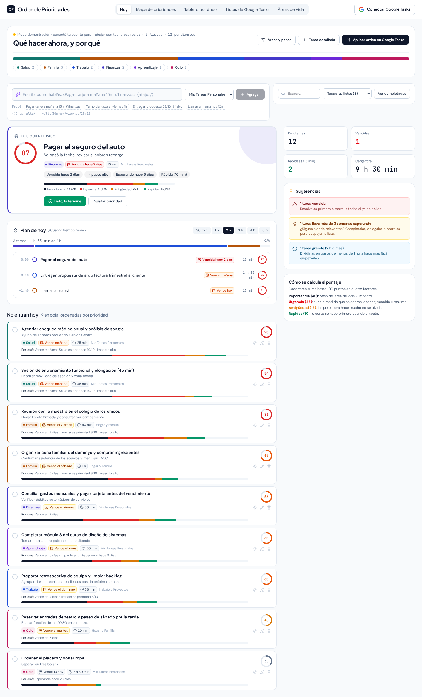

# Orden de Prioridades — Google Tasks

Prioriza tus listas de Google Tasks según tus áreas de vida (Salud, Familia, Trabajo, Finanzas, Aprendizaje, Ocio), la fecha límite, el impacto, la antigüedad y el tiempo que lleva cada tarea, y reflejá el orden resultante en Google Tasks.

## Qué hace



- **Hoy**: te dice cuál es la siguiente tarea y por qué, y arma un plan del día según el tiempo que tengas (30 min a 6 h). Las vencidas, las que vencen hoy y las críticas siempre entran primero.
- **Captura en lenguaje natural**: `Pagar tarjeta mañana 15m #finanzas !alta` crea la tarea con fecha, duración, área y urgencia. También entiende `hoy`, `viernes`, `28/10`, `en 3 días`, `próxima semana`, `1h30`, `!!!`, `*alto`. Atajo: `/`.
- **Mapa de prioridades**: gráfico de urgencia contra importancia (matriz de Eisenhower) donde cada burbuja es una tarea.
- **Tablero por áreas**: arrastrá tareas entre columnas para cambiarles el área.
- **Listas de Google Tasks**: vista previa del orden que se va a aplicar en cada lista, respetando subtareas.
- **Áreas de vida**: ajustá el peso de cada área y compará lo que te importa contra dónde está tu carga.

## Cómo se calcula el puntaje (0 a 100)

| Factor | Máx. | Qué mide |
| --- | --- | --- |
| Importancia | 40 | Peso del área (1 a 10) combinado con el impacto de la tarea |
| Urgencia | 35 | Sube a medida que se acerca la fecha límite; vencida = máximo. Sin fecha, usa la urgencia manual |
| Antigüedad | 15 | Tiempo esperando (curva logarítmica) más un bono para la más vieja de cada área |
| Rapidez | 10 | Las tareas cortas suman más, para destrabar pendientes rápidos |

Los metadatos (área, urgencia, impacto, minutos y fecha de carga) se guardan en las notas de cada tarea de Google Tasks, así no se pierden entre dispositivos.

## Correr en local

```bash
npm install
npm run dev     # http://localhost:3000
npm test        # tests del motor de prioridad
npm run build
```

Sin iniciar sesión funciona en **modo demostración** con tareas de ejemplo.

## Conectar tu cuenta de Google Tasks

El login usa Firebase Authentication con Google y pide el permiso `https://www.googleapis.com/auth/tasks`. La configuración está en `firebase-applet-config.json`.

Si la app corre fuera de Google AI Studio (por ejemplo en localhost o en tu propio hosting):

1. En la [consola de Firebase](https://console.firebase.google.com/) del proyecto, en **Authentication → Settings → Authorized domains**, agregá el dominio donde corre la app (por ejemplo `localhost`).
2. En [Google Cloud Console](https://console.cloud.google.com/apis/library/tasks.googleapis.com) del mismo proyecto, habilitá **Google Tasks API**.
3. En **APIs & Services → OAuth consent screen**, agregá el scope de Google Tasks y, mientras la app esté en modo prueba, agregá tu email como usuario de prueba.
4. Al iniciar sesión, marcá la casilla «Crear, editar, organizar y eliminar todas tus tareas».

Si preferís usar tu propio proyecto de Firebase, reemplazá los valores de `firebase-applet-config.json` por los de tu app web.
